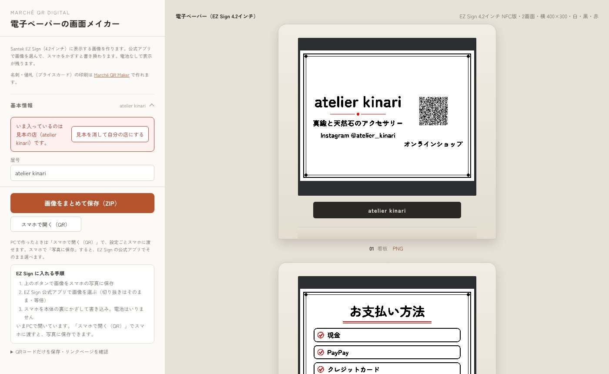

# Marché QR DIGITAL（Marche-qr-DIGITAL）

マルシェ・クラフトフェアの出店者向けに、**電子ペーパーに表示する画面**（看板・お支払い方法・商品と価格・営業中／休憩中／本日完売など）をつくる無料のWebアプリです。インストール不要、ブラウザだけで動きます。

**▶ アプリを開く：https://tsuchicco0113-png.github.io/Marche-qr-DIGITAL/**

名刺・値札（プライスカード）・QR決済カードの**印刷**は、姉妹アプリの [Marché QR Maker](https://tsuchicco0113-png.github.io/Marche-qr/) で作れます。

## 対応している電子ペーパー

| 機械 | 画面 | 書き換え方 |
|---|---|---|
| Santek **EZ Sign 4.2インチ**（NFC版） | 400×300・白黒／白黒赤／4色 | 画像をスマホの写真に保存 → EZ Sign 公式アプリで選ぶ → 本体の裏にスマホをかざす（電池不要） |
| M5Stack **PaperDIY 4.7インチ** | 960×540・16階調 | microSD に入れる、またはUSBケーブルで書き込み。本体のボタンで画面を切り替え |

## EZ Sign とスタンドを買った方へ

スタンドに付いているカードのQRから開くと、EZ Sign 用の設定（横向き・色数・スタンド表示・「看板」1枚）で始まります。

1. 「見本を消して自分の店にする」を押して、屋号・紹介文・リンクを入れる
2. 画面の上に出ている小さなプレビューで仕上がりを確認
3. 「写真に保存 → EZ Sign アプリで選ぶ」を押す
4. EZ Sign 公式アプリで画像を選び（切り抜きはそのまま・等倍）、スマホを本体の裏にかざす

「売り切れ」「休憩中」などの画面も作っておけば、その場でかざして差し替えられます。

### URLの後ろにつけるもの（同梱カード用）

| つけるもの | 開いたときの状態 |
|---|---|
| `?ez` | EZ Sign 4.2インチ・横・白黒赤 |
| `?dev=ez42&pal=bw` | 色数を指定（`bw` 白黒／`bwr` 白黒赤／`bwry` 4色） |
| `&orient=port` | 縦向き（`land` で横） |
| `&color=<色のid>` | スタンドの色（id は `STAND_COLORS`。HEXA STAGE Studio の filaments.json と同じ） |
| `?dev=diy` | PaperDIY |

読み取ったあと、これらはURLから消え、設定はブラウザに残ります。URLをつけずに初めて開いたときは「どの電子ペーパーに表示しますか？」と1回だけ聞きます。

## できること

- 画面の種類：看板（屋号・QR）・SNSのQR・本日のラインナップ（商品と価格）・営業中／休憩中／本日完売・お支払い方法・次回の出店・自由メモ・手書き・写真／イラスト
- QRの行き先：このアプリが表示する「リンクまとめページ」（内容はURLの中に入るのでサーバー不要）、またはお好きなURL
- 紙面のデザイン：枠・書体（丸ゴシック・手書き風など）・文字の大きさ・ロゴの位置（ドラッグで自由配置も可）・ディザ／網点
- HEXA STAGE のスタンドに入れた見た目でプレビュー。スタンドの色に合う配色のおすすめ
- 保存：スマホなら「写真に保存」（1枚ずつ／まとめて）、PCならZIP。「スマホで開く（QR）」で設定ごとスマホへ
- JSONの書き出し・読み込み（Marché QR Maker と同じ形式。屋号・リンク・商品をそのまま行き来できます）

## PaperDIY で使うとき

`paperdiy/MarcheDisplay/MarcheDisplay.ino` を Arduino IDE で書き込みます（アプリのZIPにも同じものが入っています）。

- ボード：M5Stack（ボードマネージャで M5Stack 3.3.10 以降）
- 画像の置き場所：microSD → LittleFS → FFat の順に探します
- ボタンB：次の画面／ボタンA：前の画面／ボタンB長押し：電源オフ
- アプリの「PaperDIYに書き込む（USB）」から、ケーブルで直接送れます（Chrome / Edge）

## 安心してお使いいただくために

- 入力した内容はお使いのブラウザの中だけに保存され、どこにも送信されません
- 単一のHTMLファイルなので、`index.html` をダウンロードすればオフラインでも動きます

「EZ Sign」は株式会社サンテクノロジーの製品です。このアプリは HEXA STAGE が独自に作っているもので、同社の公式アプリではありません。

## ライセンス

MIT License — © 2026 HEXA STAGE (Sasaki Planning)

Powered by [HEXA STAGE](https://hexa-stage.booth.pm/)
